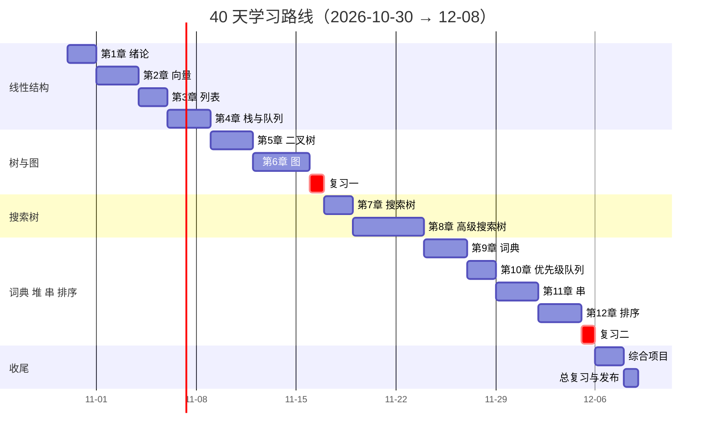
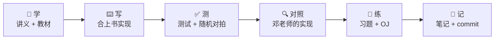

<div align="center">

# 📚 tsinghua-dsa-selfstudy

**40 天，从零实现邓俊辉《数据结构（C++语言版）》全书**

清华大学 2026 秋季学期讲义 · 第 3 版教材 · 12 章 · 每个结构都亲手写、亲手测

[](https://github.com/AzenAnn/tsinghua-dsa-selfstudy/actions/workflows/ci.yml) <!-- badge:start --><!-- badge:end -->   

[学习路线](#roadmap) · [40 天计划](PLAN.md) · [快速开始](#quickstart) · [OJ 题单](learn/problems/README.md) · [邓老师的资料](deng/README.md)

</div>

> *What I cannot create, I do not understand.* —— Richard Feynman

## ✨ 这个仓库在做什么

- 🛠️ **从零实现**：向量、列表、二叉树、图、AVL、伸展树、B-树、红黑树、跳表、散列、左式堆、KMP、BM……全书的结构和算法都合上书自己写一遍。
- ✅ **严格验证**：每个实现都有边界测试，再和 `std` 随机对拍上万次；全程开着 AddressSanitizer 和 UBSan，抓越界和内存泄漏。
- 📏 **理论对照实测**：分摊分析、指数与多项式、各种增量序列……用计时程序画出曲线，看实测和理论是否吻合。
- 📝 **吃透原理**：每章一份笔记，写清不变式、复杂度证明、易错点，以及和邓老师实现的差异；课后习题和 OJ 题配套完成。

## 📈 进度

<!-- progress:start -->
`◧□□□□□□□□□□□□□□□□□□□□□□□□□□□□□□□□□□□□□□□`

| 项目 | 进度 |
|---|---|
| 天数 | 0 / 40 |
| 计划里的任务 | 3 / 235 |
| 下一步 | D01 · 10-30 周五 · 搭环境 ＋ 第1章 绪论（上） |
| OJ 题（learn/problems/README.md） | 0 / 182 道 |
| 课后习题（learn/exercises/） | 0 / 292 道 |

■ 完成　◧ 做了一部分　□ 还没开始。这一块由 `python3 tools/progress.py` 生成，不要手改。
<!-- progress:end -->

<a id="roadmap"></a>

## 🗺️ 学习路线



| 章 | 天数 | 核心实现 | 笔记 |
|:---:|:---:|---|:---:|
| 1 绪论 | D01–02 | 起泡排序、快速幂、递归与递归消除、Fibonacci、gcd、LCS | [📝](learn/notes/ch01-绪论.md) |
| 2 向量 | D03–05 | 动态扩容与分摊分析、三版二分查找、Fibonacci 查找、归并排序 | [📝](learn/notes/ch02-向量.md) |
| 3 列表 | D06–07 | 头尾哨兵、插入排序、选择排序、列表归并 | [📝](learn/notes/ch03-列表.md) |
| 4 栈与队列 | D08–10 | 表达式求值与逆波兰式、栈混洗、八皇后、迷宫、银行模拟 | [📝](learn/notes/ch04-栈与队列.md) |
| 5 二叉树 | D11–13 | 迭代遍历、由遍历序列重构、Huffman 编码 | [📝](learn/notes/ch05-二叉树.md) |
| 6 图 | D14–17 | BFS、DFS、拓扑排序、双连通分量、PFS 框架、Prim、Dijkstra | [📝](learn/notes/ch06-图.md) |
| 7 搜索树 | D19–20 | BST、AVL、3+4 重构 | [📝](learn/notes/ch07-搜索树.md) |
| 8 高级搜索树 | D21–25 | 伸展树、B-树、红黑树、kd-树 | [📝](learn/notes/ch08-高级搜索树.md) |
| 9 词典 | D26–28 | 跳转表、散列表、桶排序与基数排序 | [📝](learn/notes/ch09-词典.md) |
| 10 优先级队列 | D29–30 | 完全二叉堆、Floyd 建堆、左式堆 | [📝](learn/notes/ch10-优先级队列.md) |
| 11 串 | D31–33 | KMP、BM（坏字符 + 好后缀）、Karp-Rabin | [📝](learn/notes/ch11-串.md) |
| 12 排序 | D34–36 | 快速排序的各种划分、k-选取、中位数、希尔排序 | [📝](learn/notes/ch12-排序.md) |

D18、D37 是阶段复习（不看书限时重写），D38–39 做两个综合项目：用自己的 B-树写的键值库 **minikv**，用自己的 Huffman 树写的压缩工具 **huffzip**。总览见 **[PLAN.md](PLAN.md)**，每天具体怎么做见 **[learn/days/](learn/days/D01-D08/D01/README.md)**（从 D01 开始）。

## 🔁 每天的学习循环



| 时间 | 做什么 |
|---|---|
| 1.5 h | 看讲义，读教材对应的小节 |
| 2 h | 合上书实现 → `tools/test.sh` 通过 → 和邓老师的实现对照，差异记进笔记 |
| 1 h | 当天安排的课后习题（`learn/exercises/`）和 OJ 题 |
| 0.5 h | 写笔记，在当天指南末尾的完成清单里打勾，`python3 tools/progress.py`，commit 并 push |

**一章算完成**，要同时满足：

- `DSA_STRICT=1 tools/test.sh chNN` 全部通过；
- 笔记写完；
- 本章必做的课后习题（编程题、证明题）做完；
- 这一章的 OJ 题做完。

<a id="quickstart"></a>

## 🚀 快速开始

```bash
git clone https://github.com/AzenAnn/tsinghua-dsa-selfstudy.git
cd tsinghua-dsa-selfstudy
bash tools/install_deps.sh        # 一键安装环境（Ubuntu/Debian 或 macOS）
tools/test.sh                     # 编译并运行全部测试
```

还没实现的函数会显示为 **待实现**（黄色），不算失败；写完一个，它就会变成 **通过** 或 **失败**。

<details>
<summary><b>🧰 常用命令一览</b></summary>

| 命令 | 作用 |
|---|---|
| `tools/test.sh` | 编译并运行全部测试（Debug + ASan + UBSan） |
| `tools/test.sh ch02` | 只跑第2章 |
| `tools/test.sh ch02 二分` | 只跑第2章里名字含“二分”的用例 |
| `DSA_STRICT=1 tools/test.sh ch02` | “待实现”也算失败，确认一章全部完成 |
| `DSA_SEED=123 tools/test.sh ch02` | 用失败时打印的随机种子复现 |
| `tools/bench.sh ch01_fib` | Release 下运行计时程序，结果写到 `bench/results/` |
| `python3 tools/plot.py ch01_fib --log` | 把计时结果画成曲线 |
| `python3 tools/new.py problem ch02 luogu-P1908 逆序对` | 新建一道 OJ 题 |
| `tools/run.sh learn/problems/ch02/luogu-P1908-逆序对` | 编译并比对样例 |
| `tools/duipai.sh learn/problems/ch02/luogu-P1908-逆序对` | 和暴力解法随机对拍 |
| `python3 tools/progress.py` | 按每天指南里完成清单的打勾情况更新进度 |
| `python3 tools/deng.py list` | 列出邓老师代码包里的示例 |
| `python3 tools/deng.py fibonacci -- 20` | 在 Linux 上编译并运行一个示例 |

</details>

<details>
<summary><b>🔧 环境要求</b></summary>

| 工具 | 版本 | 用途 |
|---|---|---|
| g++ 或 clang++ | 支持 C++17 | 编译 |
| make | | 编译 |
| cmake | ≥ 3.16 | 组织编译和测试 |
| ninja | 可选 | 编译更快，没有时自动改用 make |
| python3 | ≥ 3.10 | `tools/` 下的脚本（只用标准库） |
| git | | 版本管理 |
| matplotlib | 可选 | `tools/plot.py` 画复杂度曲线 |

`bash tools/install_deps.sh` 安装必需的工具，加 `--plot` 另外装 matplotlib。

</details>

## 📁 目录结构

```text
tsinghua-dsa-selfstudy/
├── 📄 PLAN.md            40 天计划总览
├── 📂 learn/days/D01-D08/D01…D40/      每天的做法指南：读什么、写哪个文件、跑什么命令、怎么调试，末尾是完成清单
├── 📂 learn/include/dsa/       自己实现的数据结构：模板类的声明和实现、普通函数的声明
├── 📂 src/               普通函数的实现（第1章、栈的应用、Huffman、kd-树、散列码、线性排序、串匹配）
├── 📂 tests/             单元测试 + 随机对拍（dsa_test.h 是自带的小测试框架）
├── 📂 bench/             实测耗时，和理论复杂度对照
├── 📂 learn/notes/             每章笔记
├── 📂 learn/exercises/         教材全部 292 道课后习题，一题一个文件，已安排到每一天
├── 📂 learn/problems/          OJ 题（清华 PA、洛谷、LeetCode）
├── 📂 learn/projects/          综合项目 minikv、huffzip
├── 📂 tools/             安装、测试、计时、做题、对拍、进度统计等脚本
└── 📂 deng/              邓老师的原版示例代码与勘误（原样保留）
```

## 📐 约定

- **区间**一律左闭右开 `[lo, hi)`，秩的类型是 `dsa::Rank`（`unsigned int`），和邓老师的代码一致，方便对照。
- **待实现**：全书要写的每个函数都已经建好，函数体是 `DSA_TODO();`，文件里按天分段。测试遇到它不算失败，所以 CI 一直保持绿色。
- **文件怎么分**：模板类的声明和实现都在 `learn/include/dsa/*.h`（模板只能写在头文件里）；普通函数声明在 `learn/include/dsa/*.h`、实现在 `src/*.cpp`。
- **测试**：`tests/test_chNN_<名字>.cpp`，每个用例的名字以天数开头（如 `D03 expand：…`），所以 `tools/test.sh ch02 D03` 只跑第 3 天的用例。测试都先用参考实现自检过，并做过“故意改错看能否抓到”的检验。
- **commit 信息**以天数开头，例如 `D03: Vector 构造、扩容与分摊分析`。

## 🙏 资料来源与致谢

- 本仓库的学习内容基于 **邓俊辉** 老师的《数据结构（C++语言版）》第 3 版（清华大学出版社）和清华大学的数据结构课程。教材、讲义、示例代码和勘误均来自[课程主页](https://dsa.cs.tsinghua.edu.cn/~deng/ds/dsacpp/)，版权归原作者所有，详见 [deng/README.md](deng/README.md)。
- 教材和讲义的 PDF 体积较大，不放在仓库里，请从课程主页下载。

## 📄 许可

除 `deng/` 以外，本仓库中我自己编写的代码和笔记采用 [MIT 许可](LICENSE)。
